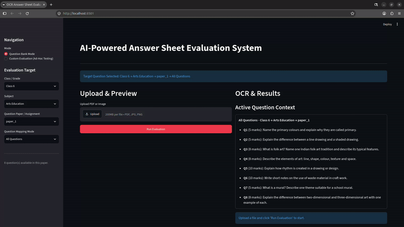
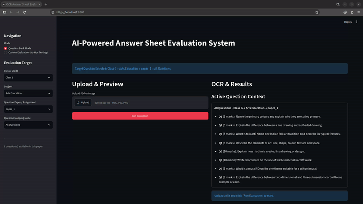

# Task OCR & Automated Answer Evaluation Engine

An end-to-end, multi-page handwritten answer sheet transcription, OCR extraction, and automated evaluation platform built with **Python 3.12**, **PyTorch**, **EasyOCR**, **Tesseract**, **Groq VLM**, **Ollama**, and **Streamlit**.

The platform is designed to process PDF and image answer sheets, assemble multi-page document text, segment question responses across page boundaries, and evaluate answers against structured question paper banks or custom ad-hoc rubrics.

---

## Key Features

- **Multi-Page OCR & Aggregation:** Ingests document pages at 300 DPI, extracts text/diagrams/smiles, and assembles continuous multi-page transcripts.
- **Hybrid Inference Engine:**
  - **Primary Cloud VLM:** High-speed inference using Groq API (`qwen3.8-27b`).
  - **Local Ollama Fallback:** Automatic offline fallback to local models (`qwen2.5-coder:7b`, `qwen3:8b`, `llama3.2:3b`).
  - **Deterministic Rule Engine:** Guaranteed fallback evaluation if LLMs are unavailable.
- **Multimodal Extraction:** Normalizes chemical SMILES formulas, LaTeX mathematical expressions, and inline `[DIAGRAM_PRESENT: ...]` markers.
- **Dual Evaluation Modes:**
  - **Question Bank Mode:** Evaluates student sheets against standard Class (6–12) / Subject / Paper CSV rubrics.
  - **Custom Evaluation Mode:** Evaluates ad-hoc questions typed manually or loaded via custom CSVs.
- **Robust Question Matching:** Maps full-document transcripts to question IDs with semantic vector block matching fallback.

---

## Project Architecture

```text
task_ocr/
├── app.py                          # Streamlit application entry point
├── app_views/                      # UI view components
│   ├── custom_eval_view.py         # Interface for ad-hoc custom question evaluation
│   ├── evaluation_view.py          # Detailed evaluation result & feedback renderer
│   └── question_bank_view.py       # Interface for Class/Subject/Paper bank evaluation
│
├── src/                            # Core engine packages
│   ├── config.py                   # Grade profiles & target scoring thresholds
│   ├── document_parser.py          # Regex & document question-block extractor
│   ├── pdf_processor.py            # PDF rendering & DPI image conversion
│   │
│   ├── data_loader/                # Hierarchy scanning & CSV parsing package
│   │   ├── core.py                 # Multi-level sample_data folder scanner
│   │   └── parsers.py              # Header normalizers, CSV reader, & path resolvers
│   │
│   ├── feedback_llm/               # Hybrid feedback LLM orchestrator package
│   │   ├── core.py                 # Hybrid feedback generator (Groq -> Ollama -> Rule Fallback)
│   │   └── llm_client.py           # API integration for Groq & local Ollama models
│   │
│   ├── ocr_engine/                 # OCR orchestration & multimodal extraction package
│   │   ├── core.py                 # Multi-page OCR pipeline controller
│   │   ├── diagram_utils.py        # Diagram marker extraction & label normalizer
│   │   ├── formatters.py           # SMILES, LaTeX, & unified text formatters
│   │   └── groq_client.py          # Groq VLM API parser & response processor
│   │
│   └── rubric_evaluator/           # Answer scoring & evaluation engine package
│       ├── core.py                 # Main rubric evaluation controller
│       ├── feature_extractors.py   # Keyword matching, cosine similarity, & equation checks
│       ├── payload_mappers.py      # Question block semantic matching & tag normalizer
│       └── scoring.py              # Grade profile score calculation matrices
│
├── sample_data/                    # Structured Class 6-12 CSV paper hierarchy
├── test_data/                      # PDF and image test sheets for ad-hoc validation
├── tests/                          # Automated Pytest suite (52 passing unit tests)
│
├── pytest.ini                      # Pytest runner configuration
├── requirements.txt                # Pinned project dependencies
└── README.md                       # Architecture docs & setup tutorial
```

## Installation & Requirements

### 1. Clone & Setup Virtual Environment

```bash
cd ~/Documents/collegepur/task_ocr
python3 -m venv .venv
source .venv/bin/activate
```

### 2. Install Dependencies

```bash
pip install -r requirements.txt
```

### 3. Setup Environment Variables
For online Groq VLM acceleration, export your API key:

```bash
export GROQ_API_KEY="your_groq_api_key_here"
```

If GROQ_API_KEY is not set, the application automatically uses local Ollama (qwen2.5-coder:7b / qwen3:8b) if available or falls back to EasyOCR/Tesseract.

### 4. Running Unit Tests

```bash
pytest -v
```

### 5. Running the Application

Follow this step-by-step tutorial to run your first automated answer sheet evaluation.

#### Step 1: Launch the Streamlit App

```bash
source .venv/bin/activate
streamlit run app.py
```

#### Step 2: Evaluate Using Question Bank Mode
1) In the sidebar under Evaluation Target, select:
    - Class / Grade: Class [6-12] (time being use test_data)
    - Subject: Appropriate NCERT subject (e.g., Economics, Geography, Polity in test_data)
    - Question Paper: Economics (paper_1 and question)
    - Question Mapping Mode: All Questions (or select a specific single question)

2) Under Upload & Preview on the left column:
    - Upload a sample PDF or image answer sheet.
    - Preview the rendered 150 DPI page thumbnails.

3) Click Run Evaluation.

4) Observe the results on the right column:
    - OCR Engine Status: Displays active engine (Groq VLM / EasyOCR) and confidence metrics per page.
    - Evaluation Results: Displays awarded marks, keyword matching ratios, semantic scores, and qualitative 2-sentence feedback.
    
##### Demo:



#### Step 3: Evaluate Using Custom Mode (Ad-Hoc Testing)

1) Select Custom Evaluation Mode from the top navigation.

2) Evaluation Target:
    - Select Class 10 and Geography.
    - Choose Type Question Manually.
    - Input Question Text: What do you mean by Geoid? Discuss evidence of Earth's sphericity.
    - Set Max Marks: 10.0.

3) Handwritten Sheet Upload:
    - Upload your sample answer PDF or image sheet.

4) Click Evaluate Custom Answer.

5) View the zero-shot/rubric feedback breakdown and extracted text!

##### Demo:

